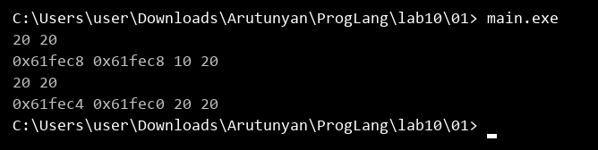
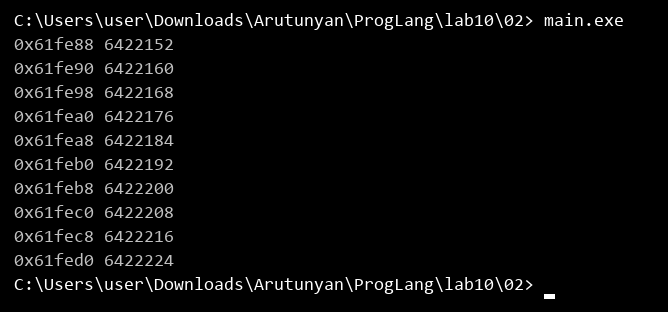
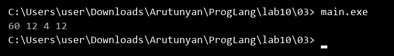
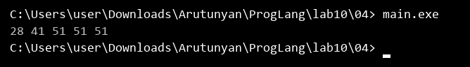
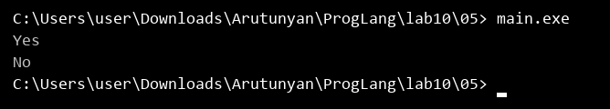
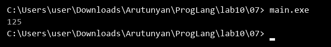
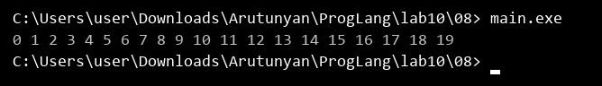
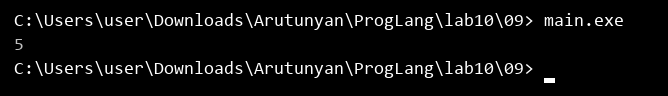
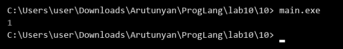
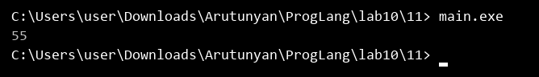

# Языки программирования
## Лабораторная работа 10

### Задание 1 (2)
*Рассмотрите следующие фрагменты программ. Запишите, что означают символы & и \* в каждом случае применения.*

```cpp
int a = 10, b = 20;
int *p = &a , *q = &b;
p = q;
std::cout << *p <<' '<< *q << std::endl;
```

```cpp
int a = 10, b = 20;
int *p = &a , *q = &b;
*p = *q;
std::cout << *p <<' '<< *q << std::endl;
```

*Чем различаются присваивания в третьей строке? Что можно вывести, чтобы показать различия?*

*Примеры программ сохраните в папке с номером задания. Скриншоты работы прикрепите к отчету.*

#### Решение

Файлы с программами:
* [01/main.cpp](01/main.cpp) — программа, объединяющая оба фрагмента с демонстрацией различий;
* [01/part1.cpp](01/part1.cpp) — первый фрагмент с присваиванием указателей;
* [01/part2.cpp](01/part2.cpp) — второй фрагмент с присваиванием разыменованных значений.

Код программы `01/main.cpp`:
```cpp
#include <iostream>

int main() {
    {
        int a = 10, b = 20;
        int *p = &a, *q = &b;
        p = q;
        std::cout << *p << ' ' << *q << std::endl;
        std::cout << p << ' ' << q << ' ' << a << ' ' << b << std::endl;
    }
    {
        int a = 10, b = 20;
        int *p = &a, *q = &b;
        *p = *q;
        std::cout << *p << ' ' << *q << std::endl;
        std::cout << p << ' ' << q << ' ' << a << ' ' << b << std::endl;
    }
    return 0;
}
```

#### Скриншот работы программы



#### Вывод программы

```
20 20
0x61fec8 0x61fec8 10 20
20 20
0x61fec4 0x61fec0 20 20
```

#### Объяснение результатов и ответы на вопросы

1. Значение символов `*` и `&` в каждом случае применения:
   * В строке `int *p = &a, *q = &b;`:
     * Символ `*` в записи `int *p` и `*q` является модификатором типа («указатель»). Он указывает компилятору, что переменные `p` и `q` имеют тип указателя на целое число (`int*`) и хранят адреса ячеек оперативной памяти.
     * Символ `&` в выражениях `&a` и `&b` является унарным оператором взятия адреса (address-of). Он возвращает физический адрес расположения переменных `a` и `b` в оперативной памяти.
   * В строке `*p = *q;`:
     * Символ `*` перед `p` и перед `q` является унарным оператором разыменования указателя (dereference). Выражение `*q` читает значение по адресу, на который указывает `q` (значение переменной `b`), а выражение `*p = ...` записывает полученное значение по адресу, на который указывает `p` (в переменную `a`).
   * В строке `std::cout << *p << ' ' << *q << std::endl;`:
     * Символ `*` перед `p` и `q` является оператором разыменования указателей. Он извлекает значения объектов, адресованных указателями, для передачи в стандартный поток вывода.

2. Различие присваиваний в третьей строке:
   * В первом фрагменте инструкция `p = q;` выполняет копирование самого указателя (копирование адреса). Значение адреса из `q` переносится в `p`. В результате оба указателя теперь ссылаются на один и тот же объект в памяти — переменную `b`. Переменная `a` при этом никак не модифицируется и сохраняет свое исходное значение 10.
   * Во втором фрагменте инструкция `*p = *q;` выполняет копирование данных по адресам (присваивание разыменованных значений). Значение объекта по адресу `q` (переменная `b`, равная 20) записывается в ячейку памяти по адресу `p` (в переменную `a`). Адреса самих указателей не изменяются (`p` по-прежнему указывает на `a`, а `q` указывает на `b`), но значение переменной `a` становится равным 20.

3. Что вывести для наглядной демонстрации различий:
   * Чтобы продемонстрировать разницу, достаточно вывести адреса, хранящиеся в указателях `p` и `q`, а также текущие значения самих переменных `a` и `b`:
     `std::cout << p << ' ' << q << ' ' << a << ' ' << b << std::endl;`
   * Для первого фрагмента адреса совпадают, а значение `a` осталось равным 10: `0x61fec8 0x61fec8 10 20`.
   * Для второго фрагмента адреса указателей различны, а значение `a` изменилось на 20: `0x61fec4 0x61fec0 20 20`.


### Задание 2 (1)
*Рассмотрим следующую программу.*

```cpp
double x[10];
for (int i = 0; i <10; i++)
    std::cout << &x[i] << std::endl;
```

*Что она выводит? Измените вывод так, чтобы адреса выводились в десятичной системе счисления. Объясните почему числа составляют арифметическую прогрессию с определенным шагом.*

*Записанную программу сохраните в папке с номером задания. Скриншоты работы прикрепите к отчету.*

#### Решение

Файл с программой: [02/main.cpp](02/main.cpp).

Код программы:
```cpp
#include <iostream>
#include <cstdint>

int main() {
    double x[10];
    for (int i = 0; i < 10; i++)
        std::cout << &x[i] << " " << reinterpret_cast<uintptr_t>(&x[i]) << std::endl;
    return 0;
}
```

#### Скриншот работы программы



#### Вывод программы

```
0x61fe88 6422152
0x61fe90 6422160
0x61fe98 6422168
0x61fea0 6422176
0x61fea8 6422184
0x61feb0 6422192
0x61feb8 6422200
0x61fec0 6422208
0x61fec8 6422216
0x61fed0 6422224
```

#### Объяснение результатов и ответы на вопросы

1. Что выводит исходная программа:
   Исходная программа выводит шестнадцатеричные адреса ячеек оперативной памяти десяти последовательных элементов массива `x`.

2. Как изменить вывод на десятичную систему счисления:
   По умолчанию поток вывода `std::cout` форматирует указатели в шестнадцатеричной системе счисления. Для получения адреса в десятичной форме указатель необходимо явно привести к целочисленному типу `uintptr_t` (или `size_t`) с помощью оператора `reinterpret_cast<uintptr_t>(&x[i])`. Для наглядности и полного соответствия заданию в программе выводятся обе формы: шестнадцатеричный адрес и десятичный эквивалент.

3. Почему адреса образуют арифметическую прогрессию с определенным шагом:
   По стандарту языка C++ массив представляет собой непрерывный блок памяти. Элементы массива размещаются в оперативной памяти строго последовательно друг за другом без каких-либо зазоров или выравнивающих интервалов.
   Тип элементов массива — `double`. На используемой платформе размер одного элемента типа `double` равен ровно 8 байтам (`sizeof(double) == 8`).
   Адрес элемента с индексом `i` вычисляется как базовый адрес массива плюс смещение: `базовый_адрес + i * sizeof(double)`.
   Следовательно, разность между адресами любых двух соседних элементов `&x[i+1]` и `&x[i]` в байтах строго равна 8:
   `6422160 - 6422152 = 8`,
   `6422168 - 6422160 = 8` и так далее.
   Последовательность десятичных адресов представляет собой классическую арифметическую прогрессию с начальным членом 6422152 и постоянным шагом (разностью), равным 8.


### Задание 3 (2)
*Токен «\*» в языке C++ может использоваться в трех различных случаях. Аналогично токен «&» также может использоваться в трех случаях. Приведите пример одной программы в которой они были бы использованы во всех случаях.*

*Записанную программу сохраните в папке с номером задания.*

#### Решение

Файл с программой: [03/main.cpp](03/main.cpp).

Код программы:
```cpp
#include <iostream>

int main() {
    int a = 12;
    int b = 5;

    int mult = a * b;
    int *ptr = &a;
    int deref = *ptr;

    int bitwise_and = a & b;
    int *addr = &b;
    int &ref = a;

    std::cout << mult << " " << deref << " " << bitwise_and << " " << ref << std::endl;
    return 0;
}
```

#### Скриншот работы программы



#### Вывод программы

```
60 12 4 12
```

#### Объяснение трех случаев использования токенов

1. Случаи использования токена `*`:
   * Бинарная арифметическая операция умножения чисел: `int mult = a * b;` (вычисляет произведение значений `12 * 5 = 60`).
   * Модификатор типа при объявлении переменной-указателя: `int *ptr = &a;` (сообщает, что переменная `ptr` хранит адрес ячейки памяти типа `int`).
   * Унарная операция разыменования указателя: `int deref = *ptr;` (извлекает значение, хранящееся по адресу в указателе `ptr`, то есть 12).

2. Случаи использования токена `&`:
   * Бинарная операция побитового логического И (bitwise AND): `int bitwise_and = a & b;` (для чисел 12 в двоичном виде `1100` и 5 в двоичном виде `0101` побитовое И дает `0100`, то есть число 4).
   * Унарная операция взятия адреса переменной: `int *addr = &b;` (возвращает адрес расположения переменной `b` в памяти).
   * Модификатор типа при объявлении ссылки: `int &ref = a;` (создает ссылку `ref`, являющуюся альтернативным именем (псевдонимом) для существующей переменной `a`).


### Задание 4 (2)
*Выпишите значения всех переменных, в том числе указателей, после выполнения каждой инструкции программы. Объясните, что происходит в результате выполнения каждой инструкции.*

```cpp
unsigned a = 8, b = 3 ,c = 17;
unsigned *p = &a;
unsigned *q = &b;
*p += *q + c;
c = *q;
p = &c;
c += a;
*p += 10;
*q = *p;
q = p ;
*q += 10;
```

#### Решение

Файл с проверочной программой: [04/main.cpp](04/main.cpp).

Код программы:
```cpp
#include <iostream>

int main() {
    unsigned a = 8, b = 3, c = 17;
    unsigned *p = &a;
    unsigned *q = &b;
    *p += *q + c;
    c = *q;
    p = &c;
    c += a;
    *p += 10;
    *q = *p;
    q = p;
    *q += 10;
    std::cout << a << " " << b << " " << c << " " << *p << " " << *q << std::endl;
    return 0;
}
```

#### Скриншот работы программы



#### Вывод программы

```
28 41 51 51 51
```

#### Пошаговая таблица состояний переменных

| Шаг | Выполняемая инструкция | a | b | c | p (адрес / значение) | q (адрес / значение) |
|---|---|---|---|---|---|---|
| 1 | `unsigned a = 8, b = 3, c = 17;` | 8 | 3 | 17 | не объявлен | не объявлен |
| 2 | `unsigned *p = &a;` | 8 | 3 | 17 | `&a` (`*p = 8`) | не объявлен |
| 3 | `unsigned *q = &b;` | 8 | 3 | 17 | `&a` (`*p = 8`) | `&b` (`*q = 3`) |
| 4 | `*p += *q + c;` | 28 | 3 | 17 | `&a` (`*p = 28`) | `&b` (`*q = 3`) |
| 5 | `c = *q;` | 28 | 3 | 3 | `&a` (`*p = 28`) | `&b` (`*q = 3`) |
| 6 | `p = &c;` | 28 | 3 | 3 | `&c` (`*p = 3`) | `&b` (`*q = 3`) |
| 7 | `c += a;` | 28 | 3 | 31 | `&c` (`*p = 31`) | `&b` (`*q = 3`) |
| 8 | `*p += 10;` | 28 | 3 | 41 | `&c` (`*p = 41`) | `&b` (`*q = 3`) |
| 9 | `*q = *p;` | 28 | 41 | 41 | `&c` (`*p = 41`) | `&b` (`*q = 41`) |
| 10 | `q = p;` | 28 | 41 | 41 | `&c` (`*p = 41`) | `&c` (`*q = 41`) |
| 11 | `*q += 10;` | 28 | 41 | 51 | `&c` (`*p = 51`) | `&c` (`*q = 51`) |

#### Подробное описание каждого шага

1. `unsigned a = 8, b = 3, c = 17;`
   Создаются и инициализируются три беззнаковые целочисленные переменные: `a = 8`, `b = 3`, `c = 17`.
2. `unsigned *p = &a;`
   Объявляется указатель `p`, в который записывается адрес переменной `a`. Теперь `p` указывает на `a`, и `*p` равно 8.
3. `unsigned *q = &b;`
   Объявляется указатель `q`, в который записывается адрес переменной `b`. Теперь `q` указывает на `b`, и `*q` равно 3.
4. `*p += *q + c;`
   Вычисляется сумма `*q + c = 3 + 17 = 20`. Результат прибавляется к значению по адресу `p` (в переменную `a`): `a = 8 + 20 = 28`.
5. `c = *q;`
   Переменной `c` присваивается значение по адресу `q` (значение переменной `b`, равное 3). Значение `c` становится равным 3.
6. `p = &c;`
   Указателю `p` присваивается адрес переменной `c`. Теперь `p` указывает на `c`, а значение `*p` равно 3.
7. `c += a;`
   К переменной `c` прибавляется значение переменной `a`: `c = 3 + 28 = 31`. Так как `p` указывает на `c`, значение `*p` также становится равным 31.
8. `*p += 10;`
   Значение по адресу `p` (переменная `c`) увеличивается на 10: `c = 31 + 10 = 41`.
9. `*q = *p;`
   Значению по адресу `q` (переменной `b`) присваивается значение по адресу `p` (переменная `c`, равная 41). Переменная `b` становится равной 41.
10. `q = p;`
    Указателю `q` присваивается значение указателя `p` (адрес переменной `c`). Теперь оба указателя `p` и `q` указывают на одну и ту же переменную `c`.
11. `*q += 10;`
    Значение по адресу `q` (переменная `c`) увеличивается на 10: `c = 41 + 10 = 51`. Так как оба указателя адресуют `c`, значения `*p` и `*q` одновременно становятся равными 51.


### Задание 5 (1)
*Что сравнивается в приведенной ниже программе? Как можно изменить первую строчку программы, чтобы результат тоже изменился?*

```cpp
int x = 1, y = 2;
int *p = &y, *q = &x;
if (p < q)
    std::cout << "Yes";
else
    std::cout << "No";
```

#### Решение

Файл с программой: [05/main.cpp](05/main.cpp).

Код программы:
```cpp
#include <iostream>

int main() {
    {
        int x = 1, y = 2;
        int *p = &y, *q = &x;
        if (p < q)
            std::cout << "Yes" << std::endl;
        else
            std::cout << "No" << std::endl;
    }
    {
        int y = 2, x = 1;
        int *p = &y, *q = &x;
        if (p < q)
            std::cout << "Yes" << std::endl;
        else
            std::cout << "No" << std::endl;
    }
    return 0;
}
```

#### Скриншот работы программы



#### Вывод программы

```
Yes
No
```

#### Ответы на вопросы

1. Что сравнивается в программе:
   В условии `if (p < q)` сравниваются не значения самих переменных 1 и 2, а значения указателей `p` и `q`, то есть физические адреса ячеек памяти, в которых размещены переменные `y` и `x` (`&y < &x`).
2. Как изменить первую строчку программы, чтобы изменился результат:
   В архитектуре x86/x64 стек вызовов традиционно растет сверху вниз (в сторону убывания адресов). Компилятор размещает локальные переменные в порядке их объявления: переменная `x` размещается первой по большему адресу, а переменная `y` — следующей по меньшему адресу. Поэтому адрес `&y` оказывается численно меньше адреса `&x`, условие `p < q` истинно, и программа выводит `Yes`.
   Если изменить первую строчку, поменяв порядок объявления переменных:
   `int y = 2, x = 1;`
   то первой в стеке по большему адресу будет размещена переменная `y`, а следом за ней по меньшему адресу — переменная `x`. В этом случае адрес `p` (`&y`) станет больше адреса `q` (`&x`), условие `p < q` окажется ложным, и программа выведет `No`.


### Задание 6 (2)
*Объясните работу следующей программы. Как изменится результат, если тип double изменить на некоторый другой, например int или char?*

```cpp
double x = 0;
double *d = &x;
std::cout << reinterpret_cast<size_t>(d + 4) - reinterpret_cast<size_t>(d - 4) << std::endl;
```

#### Решение

Файл с программой: [06/main.cpp](06/main.cpp).

Код программы:
```cpp
#include <iostream>

int main() {
    double x = 0;
    double *d = &x;
    std::cout << reinterpret_cast<size_t>(d + 4) - reinterpret_cast<size_t>(d - 4) << std::endl;
    return 0;
}
```

#### Скриншот работы программы


#### Вывод программы

```
64
```

#### Ответы на вопросы и подробное объяснение

1. Работа программы:
   * Переменная `d` имеет тип `double*`.
   * Согласно правилам адресной арифметики C++, операции сложения и вычитания указателя с целым числом автоматически масштабируются на размер адресуемого типа. Смещение указателя на `N` позиций изменяет адрес в байтах на `N * sizeof(T)`.
   * Выражение `d + 4` дает адрес, смещенный вперед на `4 * sizeof(double) = 4 * 8 = 32` байта.
   * Выражение `d - 4` дает адрес, смещенный назад на `4 * sizeof(double) = 4 * 8 = 32` байта.
   * Оператор `reinterpret_cast<size_t>` преобразует полученные указатели в числовой тип `size_t`, представляющий байтовый адрес в памяти.
   * Затем знак минус выполняет обычное арифметическое вычитание двух чисел: `(адрес + 32) - (адрес - 32) = 64`.
   * Программа выводит 64.

2. Как изменится результат при смене типа:
   Результирующее число вычисляется по формуле: `(4 - (-4)) * sizeof(T) = 8 * sizeof(T)`.
   * При типе `int`: `sizeof(int) = 4`, результат равен `8 * 4 = 32`.
   * При типе `char`: `sizeof(char) = 1`, результат равен `8 * 1 = 8`.
   * При типе `short`: `sizeof(short) = 2`, результат равен `8 * 2 = 16`.


### Задание 7 (2)
*Объясните работу следующей программы. Как изменится результат, если тип double изменить на некоторый другой, например int или char?*

```cpp
std::cout << reinterpret_cast <double*>(3000) - reinterpret_cast <double*>(2000) << std::endl;
```

#### Решение

Файл с программой: [07/main.cpp](07/main.cpp).

Код программы:
```cpp
#include <iostream>

int main() {
    std::cout << reinterpret_cast<double*>(3000) - reinterpret_cast<double*>(2000) << std::endl;
    return 0;
}
```

#### Скриншот работы программы



#### Вывод программы

```
125
```

#### Ответы на вопросы и подробное объяснение

1. Работа программы:
   * Выражения `reinterpret_cast<double*>(3000)` и `reinterpret_cast<double*>(2000)` преобразуют числовые значения 3000 и 2000 в адреса памяти соответствующего типа указателя `double*`.
   * Оператор вычитания `-` между двумя указателями одного типа `T*` возвращает разность указателей (тип `ptrdiff_t`).
   * По стандарту языка C++, результатом вычитания двух указателей является количество элементов базового типа, которые помещаются в диапазоне между этими адресами: `(адрес_1 - адрес_2) / sizeof(T)`.
   * Разность адресов в байтах равна `3000 - 2000 = 1000`.
   * Для типа `double` размер `sizeof(double) = 8`. Выполняется деление `1000 / 8 = 125`.
   * Программа выводит число 125.

2. Как изменится результат при смене типа:
   Результат вычисляется по формуле `(3000 - 2000) / sizeof(T) = 1000 / sizeof(T)`:
   * При типе `int`: `sizeof(int) = 4`, результат равен `1000 / 4 = 250`.
   * При типе `char`: `sizeof(char) = 1`, результат равен `1000 / 1 = 1000`.
   * При типе `short`: `sizeof(short) = 2`, результат равен `1000 / 2 = 500`.


### Задание 8 (2)
*Что надо дописать в записанной ниже программе вместо многоточий, чтобы она выводила все числа из массива a? Почему?*

```cpp
int a[20];
for ( int i = 0; i < 20; i++)
    a[i] = i;
int *b=a + 8;
for (int i =...; i <...; i++)
    std::cout << b[i] <<' ';
```

#### Решение

Файл с программой: [08/main.cpp](08/main.cpp).

Код программы:
```cpp
#include <iostream>

int main() {
    int a[20];
    for (int i = 0; i < 20; i++)
        a[i] = i;
    int *b = a + 8;
    for (int i = -8; i < 12; i++)
        std::cout << b[i] << ' ';
    std::cout << std::endl;
    return 0;
}
```

#### Скриншот работы программы



#### Вывод программы

```
0 1 2 3 4 5 6 7 8 9 10 11 12 13 14 15 16 17 18 19
```

#### Ответы на вопросы и обоснование

1. Что надо дописать вместо многоточий:
   Вместо многоточий нужно дописать `-8` и `12`:
   `for (int i = -8; i < 12; i++)`
   (или с нестрогим неравенством: `for (int i = -8; i <= 11; i++)`).

2. Обоснование:
   * В языке C++ оператор индексации `b[i]` по стандарту тождественно равен выражению `*(b + i)`.
   * Указатель `b` инициализирован как `a + 8`, то есть указывает на элемент `a[8]`.
   * Подстановка дает: `b[i] = *(a + 8 + i) = a[8 + i]`.
   * Массив `a` состоит из 20 элементов с индексами от 0 до 19 включительно.
   * Для доступа к первому элементу `a[0]` индекс `8 + i` должен быть равен 0, откуда начальное значение `i = -8`.
   * Для доступа к последнему элементу `a[19]` индекс `8 + i` должен быть равен 19, откуда `i = 11`. При условии строгого неравенства `i < 12` последней выполненной итерацией будет как раз `i = 11`.


### Задание 9 (2)
*Что выводит следующая программа? Изменится ли результат если изменить тип элементов массива?*

```cpp
int a[10];
std::cout << &a[8] - &a[3] << std::endl;
```

#### Решение

Файл с программой: [09/main.cpp](09/main.cpp).

Код программы:
```cpp
#include <iostream>

int main() {
    int a[10];
    std::cout << &a[8] - &a[3] << std::endl;
    return 0;
}
```

#### Скриншот работы программы



#### Вывод программы

```
5
```

#### Ответы на вопросы и обоснование

1. Что выводит программа:
   Программа выводит число 5.

2. Изменится ли результат при изменении типа элементов массива:
   Нет, результат не изменится. При любом типе элементов массива (например `double`, `char`, `short`, `long long` или произвольной структуре) программа всегда выведет 5.

3. Обоснование:
   * Вычитание двух указателей одного типа `T*`, адресующих элементы одного и того же массива, возвращает расстояние между элементами в количестве элементов типа `T`, а не в байтах.
   * Разность физических адресов в байтах равна `(8 - 3) * sizeof(T) = 5 * sizeof(T)`.
   * При вычислении разности указателей компилятор делит физическое байтовое расстояние на размер одного элемента: `(5 * sizeof(T)) / sizeof(T) = 5`.
   * Размер типа `sizeof(T)` взаимно сокращается, поэтому результат всегда равен `8 - 3 = 5` вне зависимости от типа данных.


### Задание 10 (1)
*Есть ли разница между инициализацией p и q в следующей программе? Обоснуйте ответ.*

```cpp
int x [10]={1, 2, 3, 4, 5, 6, 7, 8, 9, 10};
int *p = x + 5;
int *q = &x[5];
```

#### Решение

Файл с программой: [10/main.cpp](10/main.cpp).

Код программы:
```cpp
#include <iostream>

int main() {
    int x[10] = {1, 2, 3, 4, 5, 6, 7, 8, 9, 10};
    int *p = x + 5;
    int *q = &x[5];
    std::cout << (p == q) << std::endl;
    return 0;
}
```

#### Скриншот работы программы



#### Вывод программы

```
1
```

#### Ответ и обоснование

1. Ответ:
   Разницы нет. Обе переменные `p` и `q` инициализируются абсолютно одинаковым адресом ячейки оперативной памяти и указывают на один и тот же шестой элемент массива `x[5]` со значением 6.

2. Обоснование:
   * В выражении `int *p = x + 5;` имя массива `x` в выражении автоматически преобразуется в указатель на его первый элемент `&x[0]` (правило array-to-pointer decay). Добавление целого числа 5 смещает указатель на 5 элементов типа `int`, давая адрес ячейки `x[5]`.
   * В выражении `int *q = &x[5];` используется операция индексации. Согласно стандарту C++, выражение `x[5]` тождественно равно `*(x + 5)`. Применение оператора взятия адреса дает `&(*(x + 5))`. Операторы `&` и `*` взаимно обратны, поэтому выражение преобразуется в `x + 5`.
   * Таким образом, обе формы записи семантически тождественны и генерируют одинаковый машинный код.


### Задание 11 (3)
*Указатели можно использовать для итерации по массивам. Напишите программу, которая найдет сумму элементов массива, используя указатели. В начале цикла указатель требуется установить на начало массива, в конце каждой итерации смещать его к следующему элементу массива через инкремент. Для выхода из цикла надо проверять, что указатель дошел до конца массива.*

```cpp
int x [10]={1, 2, 3, 4, 5, 6, 7, 8, 9, 10};
int s = 0;
for (int *p = ...; ...; ...)
    s += ...
std::cout << s;
```

*Записанную программу сохраните в папке с номером задания.*

#### Решение

Файл с программой: [11/main.cpp](11/main.cpp).

Код программы:
```cpp
#include <iostream>

int main() {
    int x[10] = {1, 2, 3, 4, 5, 6, 7, 8, 9, 10};
    int s = 0;
    for (int *p = x; p < x + 10; ++p)
        s += *p;
    std::cout << s << std::endl;
    return 0;
}
```

#### Скриншот работы программы



#### Вывод программы

```
55
```

#### Объяснение работы программы

* В секции инициализации цикла `int *p = x;` указатель `p` устанавливается на первый элемент массива `&x[0]`.
* В секции условия продолжения цикла `p < x + 10` проверяется, что текущий адрес в `p` меньше адреса ячейки, расположенной непосредственно за последним элементом массива (`x + 10` — итератор конца диапазона). Как только указатель доходит до `x + 10`, цикл завершается.
* В секции инкремента `++p` указатель смещается к следующему элементу массива на каждом шаге.
* В теле цикла `s += *p;` значение текущего элемента массива извлекается с помощью операции разыменования `*p` и прибавляется к накопительной сумме `s`.
* Программа вычисляет сумму чисел от 1 до 10: `1 + 2 + 3 + 4 + 5 + 6 + 7 + 8 + 9 + 10 = 55`.
